# E-commerce Customer Support Agent System

## Module 02

GitHub Classroom at https://classroom.github.com/a/QwZ9f6p1 now redirects to the Classroom retirement notice, so this module is in this repository. Git user is already `Leonid328`. DVC remote `ecommerce` is `s3://ecommerce-bucket/dvc` on MinIO at `http://127.0.0.1:9000`. Dataset files stay out of Git and are tracked by the `data/*.dvc` pointers.

Hydra:

```bash
python scripts/data/generate_with_hydra.py products=40 customers=50 orders=60 conversations=20
```

## Screenshots

Module 1 screenshots (Streamlit): [screenshots.md](screenshots.md)

Module 02 screenshots are in `Screenshot/`.

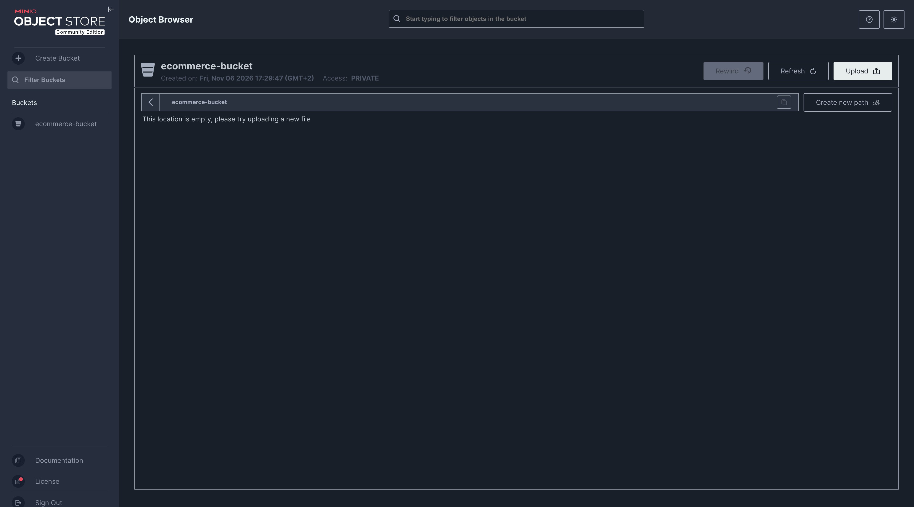
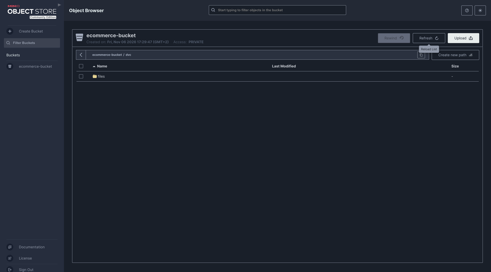
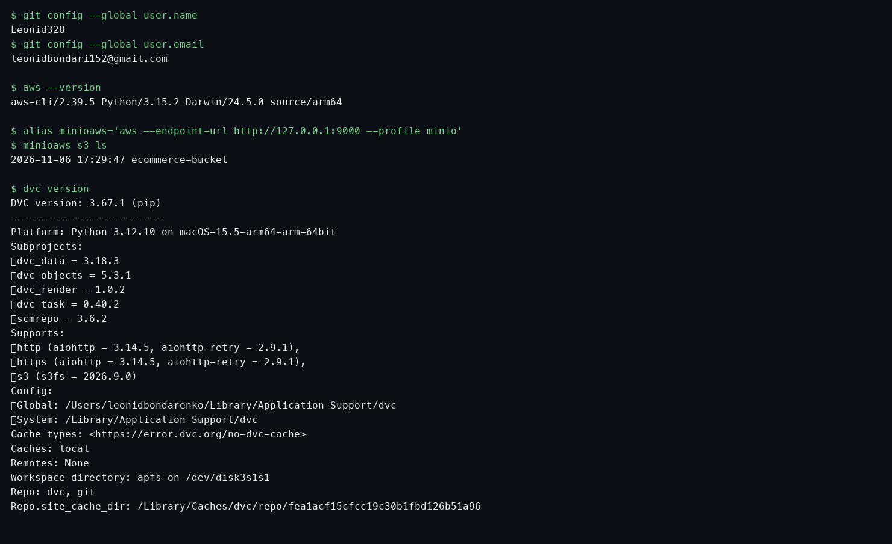
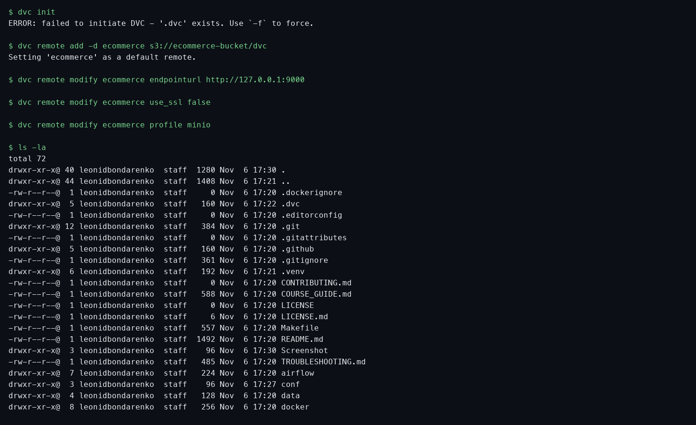
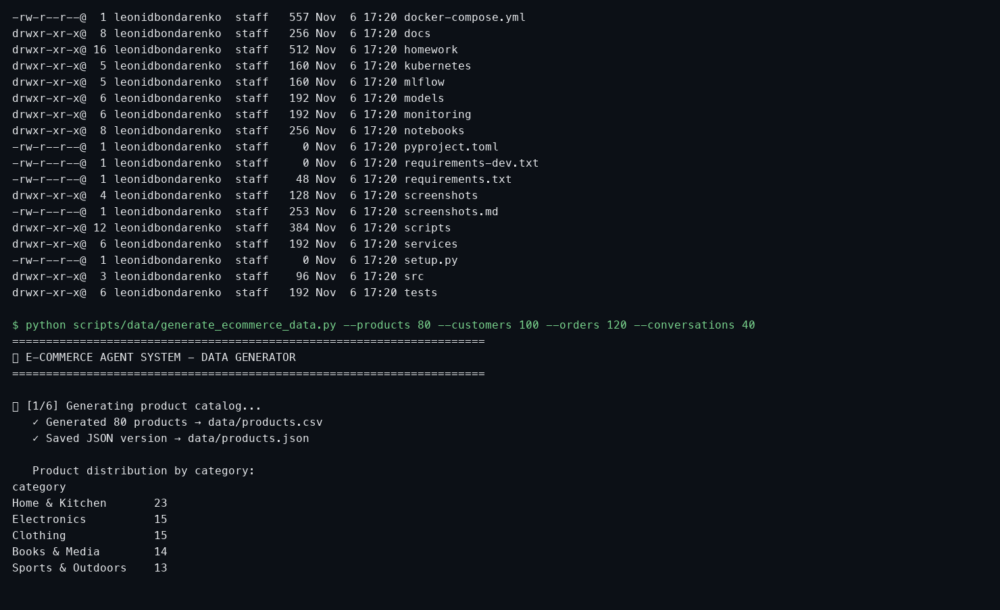
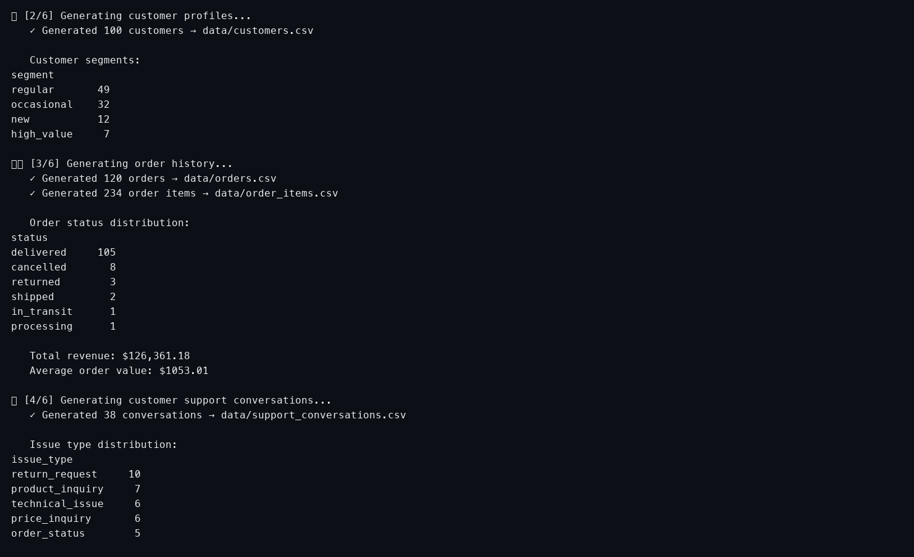
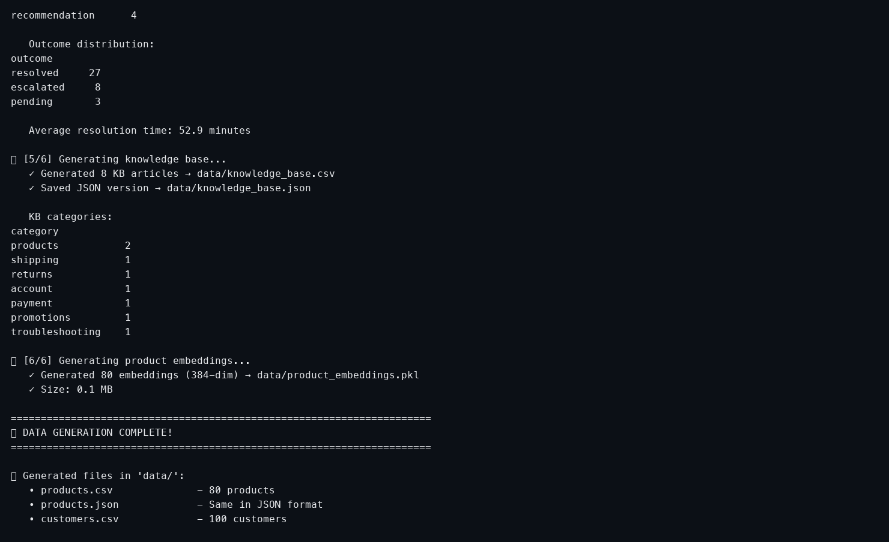
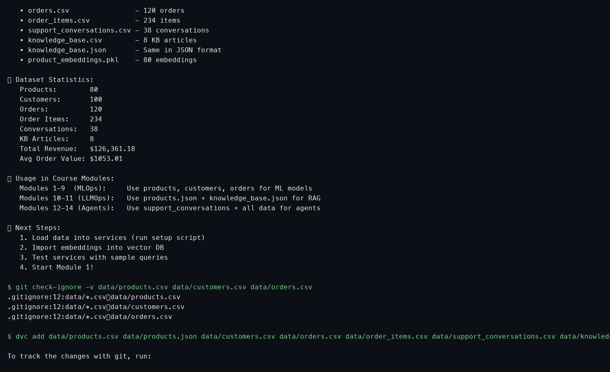
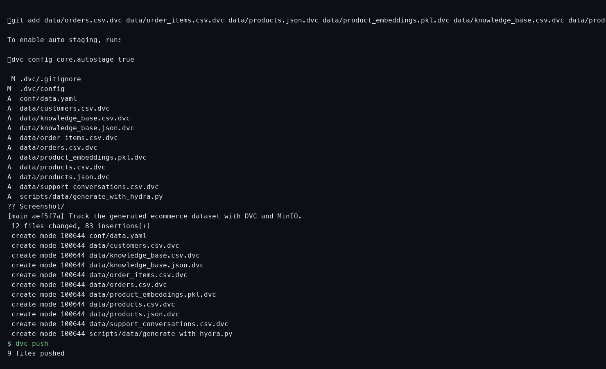
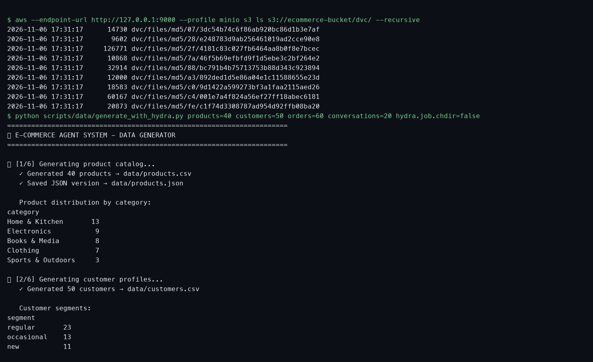
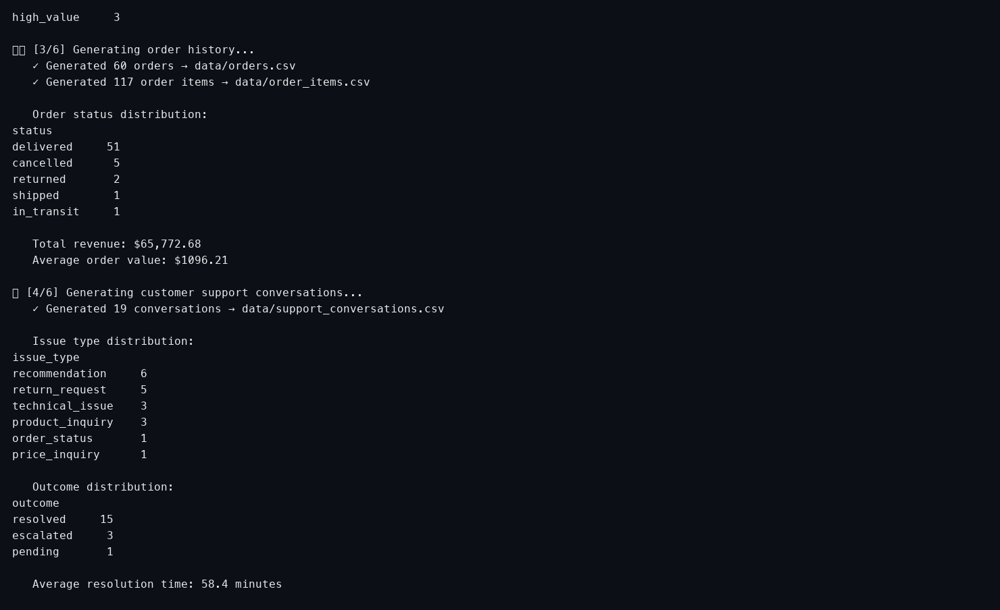
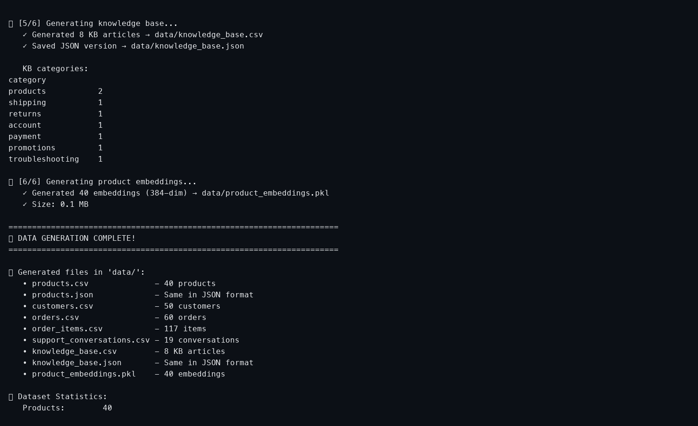
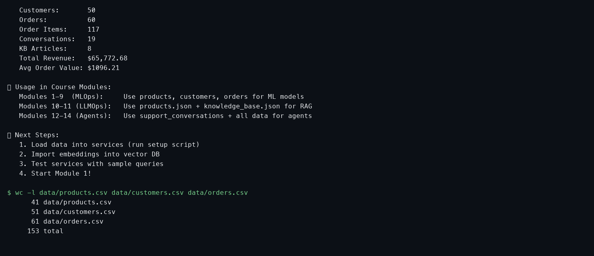

Production-ready intelligent customer support system combining ML recommendations, 
RAG-powered search, and LangChain agents.

## Quick Start
```bash
# One-command setup
./scripts/setup/init_project.sh --quick
```

## Full Start

```bash
./scripts/setup/init_project.sh --quick
```
### Initial setup info

[Initial setup README](./scripts/setup/README.md)

## Module 1: Setup

1. Clone the repository:

```bash
git clone https://github.com/mentorchita/ecommerce-start.git
cd ecommerce-start
```
3. Generate data:
```bash
python scripts/generate_data.py
```

5. Run locally (without Docker):
```bash
pip install -r requirements.txt
streamlit run src/app.py
```
7. From Docker:

```bash
docker compose up --build
```

Open: http://localhost:8501

```bash
# Access services
- ML Service: http://localhost:8001
- RAG Service: http://localhost:8002
- Agent Service: http://localhost:8003
- MLflow: http://localhost:5000
- Grafana: http://localhost:3000
```

## Course Structure

This repository supports a 14-module MLOps/LLMOps/AgenticOps course.

📖 See [COURSE_GUIDE.md](COURSE_GUIDE.md) for module-by-module breakdown.

## Documentation

- [Architecture](docs/architecture.md)
- [Module 01 Guide](docs/ops-guides/module-01-setup.md)
- [API Reference](docs/api-reference.md)
- [Troubleshooting](TROUBLESHOOTING.md)

## License

Apache 2.0 - See [LICENSE](LICENSE)
