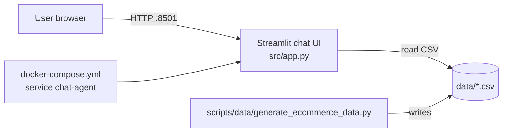

# Module 1: E-commerce Chat Agent System Architecture

**Student:** Leonid328 (Leonid Bondarenko)  
**Date:** 2026-11-02  
**Branch:** `homework/module-01/leonid328`

## 1. General architecture overview (end of module 1)

At this stage the system is a single-container MVP for MLOps onboarding:

### Components

| Component | Role | Location |
|-----------|------|----------|
| **UI** | Chat input, message history, product search results | `src/app.py` (Streamlit) |
| **Data layer** | Synthetic catalog, reviews, queries, interactions | `data/products.csv`, `reviews.csv`, `user_queries.csv`, `interactions.csv` |
| **Data generator** | Reproducible sample dataset for local/Docker runs | `scripts/data/generate_ecommerce_data.py` |
| **Runtime** | Python 3 + pandas; keyword search (`str.contains`) | No LLM/RAG in module 1 |
| **Infrastructure** | Docker Compose, port **8501**, bind mounts `./` and `./data` | `docker-compose.yml`, `docker/Dockerfile` |

### Data flow

1. Developer runs `scripts/setup/init_project.sh` (or generator + `docker compose up --build`).
2. CSV files land in `data/`.
3. Streamlit loads `products.csv` via `@st.cache_data`.
4. User message → lowercase query → filter on `name`, `category`, `description` → top 5 rows rendered in chat.

### Deployment target (VPS)

- Host: `root@76.13.249.47` (`/opt/mlops-hw/ecommerce-start`)
- Expected check: `docker compose ps` → `chat-agent` **Up**, UI at `http://76.13.249.47:8501`
